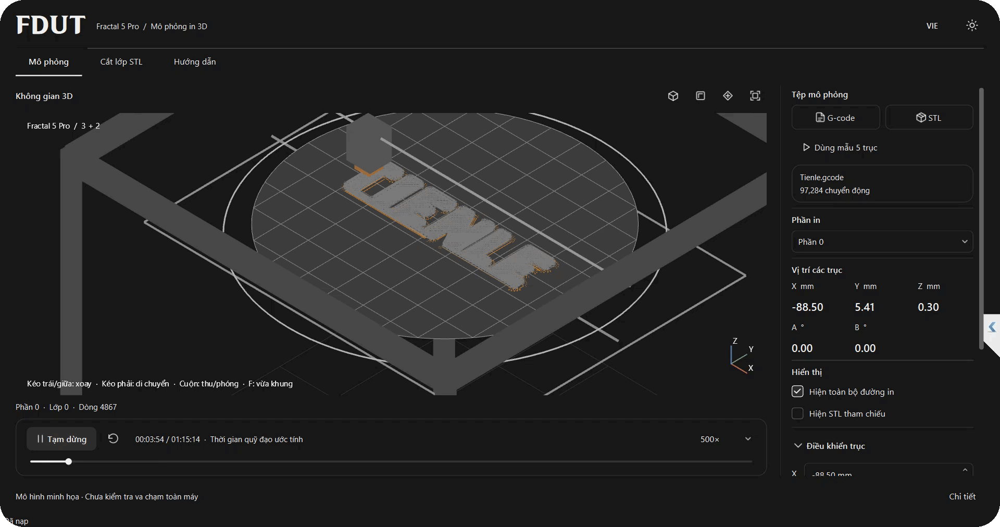

# FDUT — 5-axis 3D printing

Research into print orientation and coordinated motion for plastic additive
manufacturing, combining linear X/Y/Z movement with a rotating and tilting print bed.

[Overview](https://github.com/soun26/soun26/blob/main/projects/five-axis-3d-printing.md) · [Access](https://github.com/soun26/fdut-5axis-printing/issues/new?title=Source%20access%20request)

Current work covers virtual toolpath playback, machine motion and part orientation.
The demonstrator supports studying multi-axis printing workflows before physical
machine validation. Full-machine collision checking remains future work.

Source code is private.

[Soun](https://github.com/soun26) · Mechanical Engineering

