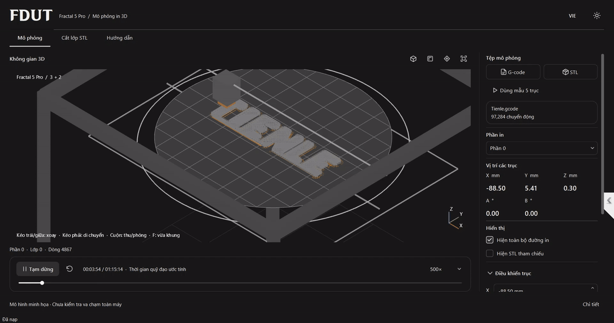

# FDUT — 5-axis 3D printing

Research into print orientation and coordinated motion for plastic additive
manufacturing, combining linear X/Y/Z movement with a rotating and tilting print bed.

[Watch the demo video →](https://github.com/soun26/fdut-5axis-printing/blob/main/docs/media/printing-demo.mp4)

Current work covers virtual toolpath playback, machine motion and part orientation.
The demonstrator supports studying multi-axis printing workflows before physical
machine validation. Full-machine collision checking remains future work.

The source code is maintained in a private repository.
[Contact me for source access →](https://github.com/soun26/fdut-5axis-printing/issues/new?title=Source%20access%20request)

[Soun](https://github.com/soun26) · Mechanical Engineering

Reference: [Fractal Robotics](https://github.com/fractalrobotics).
